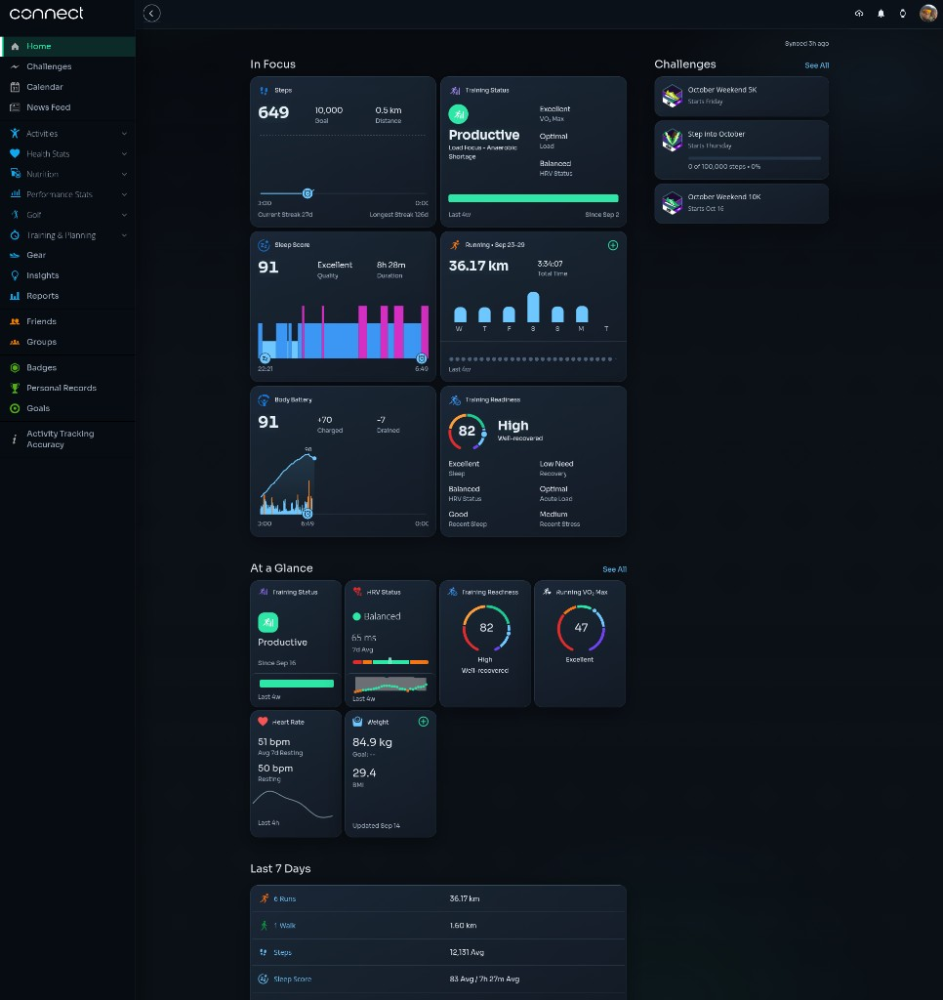

# Garmin Connect Night

Chromium MV3 extension. Dark athletic midnight theme for [Garmin Connect](https://connect.garmin.com).



## Install (unpacked)

1. Clone this repo or download a release zip.
2. Open `chrome://extensions` (or `brave://extensions`).
3. Enable **Developer mode**.
4. **Load unpacked** → select the `extension/` folder.

Toggle on/off from the toolbar popup. Reload the Garmin tab if styles stick.

## Install (zip)

Release zip has `manifest.json` at the root (ready for Chrome Web Store upload or unpacked extract).

```bash
# rebuild zip from source
(cd extension && zip -r ../garmin-connect-night.zip .)
```

## Permissions

| Permission | Why |
|---|---|
| `storage` | Remember theme on/off |
| `connect.garmin.com` | Inject CSS/JS on that host only |

No network calls. No analytics. Styles and tokens stay local.

## Develop

Edit files under `extension/`. Bump `manifest.json` `version` after changes. Reload the extension, then hard-refresh Garmin.

## License

MIT
